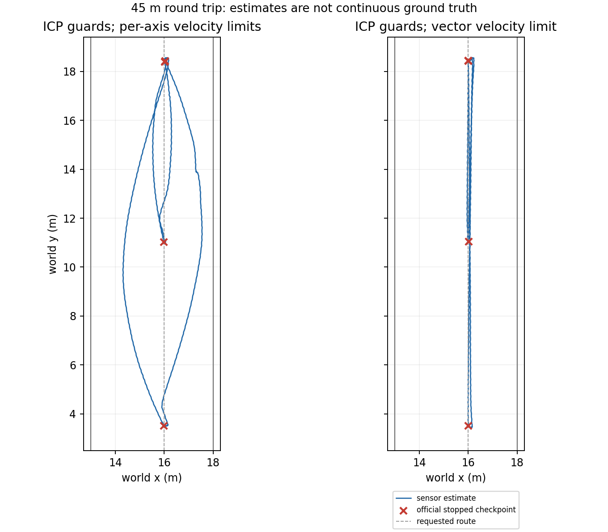

# CSH 미션 1·공통 이동·플래너 검증 — 2026-11-27 KST

이 문서의 7542e7e 기반 측정은 Starter v1 결과다. 작업 종료 전 origin/main이 Starter v2인 56f307d로 갱신되어, 아래 이력을 보존하고 v2 통합·재검증을 별도로 진행한다. v1 판정을 v2 성공으로 계산하지 않는다.

기반은 작업 시작 때 fetch한 `origin/main`의 `7542e7efbbaf1f55c47d92a8acbc12070df37538`이다. 프롬프트에 적힌 e48a9a1로 고정하지 않았다. 결과 구현 커밋은 공통 위치 추정·이동 `8382d73`, 플래너 `a1a2c2c`, 이동 벡터 제한 `a932e37`, 거절 정합 진단 `8156dd5`, 미션 4→1 평가 case `235c1ab`, IMU 끝 샘플 대기 수정 `092315b`다. 개인 브랜치는 `opt/m1-CSH-20261127-02`, worktree는 `/home/aril/rai-worktrees/CSH-m1-20261127-02`이다. 같은 CSH 이름의 다른 worktree와 진행 중인 GPU 프로세스를 발견해 별도 번호를 사용했고, 그 파일·프로세스는 수정/종료하지 않았다.

원본 `README.md`, `custom/README.md`, `docs/VALIDATION_REPORT.md`, 실제 위치의 `docs/TEAM_OPTIMIZATION.md`, 원본 API/referee/센서 발행 코드와 기존 실패 로그를 읽었다. 루트 `TEAM_OPTIMIZATION.md`와 미션 2/4 담당자의 `evaluate.py`는 현재 main에 없었다. 담당자 브랜치는 미션 2 `2284468`, 미션 4 `36d6ee5`를 따로 fetch했다. 제출 브랜치에서 그 미션 본문과 `vision.py`는 변경하지 않는다.

**가설과 구현.** 기존 KISS 경로는 정합 결과를 지도·예측에 반영한 뒤 pelvis 점프를 검사했고 KISS 품질을 사실상 1.0으로 취급했다. 불량 정합 뒤 마지막 자세로 지도를 새로 만드는 복구는 잃은 이동을 복원하지 못한다. 미션 3 원본 실패 로그에는 0.6초에 1.739m/46도, 다음 0.1초에 60도 점프와 영구 복구 제한이 있었다. 기존 발행기는 새 스캔이 없어도 같은 자세에 현재 wall-clock 시각을 붙였다. 센서·joint TF는 simulation time이고, 변환 조회는 최신 TF를 사용했다.

이 브랜치는 스캔 시각에 맞는 pelvis↔LiDAR TF, 전체 100Hz raw LiDAR IMU 이력의 회전, 실제 스캔 간격을 사용한다. IMU 외삽이나 명령 속도의 적분으로 이동을 발행하지 않는다. IMU는 회전 예측이며, 평행이동은 항상 스캔 정합으로 측정한다. 지도 갱신 전에 기존보다 완화하지 않은 이동 제한, IMU 회전 일치, 대응점 비율(≥0.55), 잔차(≤0.16m), pelvis 변환을 확인한다. 불량 스캔은 지도를 오염시키지 않고 다음 관측으로 재시도한다. 정합 간격이 센서 시각 기준 1초를 넘으면 명시적인 종료 필요 상태로 정지한다. 전역 재위치 추정은 구현하지 않았으며, 정답·공개 waypoint로 좌표를 덮어쓰지 않는다.

새 자세에만 원래 스캔 시각으로 Pose/TF를 발행한다. 추가 `localization_status` JSON 토픽은 실제 원인·품질·유효성·종료 필요 여부를 전달한다. Navigator는 무효 상태에서 정지하고 `goto/face` 안에서 최대 0.8초 재관측한다. 직접 `pose()`는 기존처럼 실패 시 예외다. 구간 정체에는 최대 두 번 재관측하고 경로는 센서 자세에서 한 번만 다시 계산한다. 같은 방 안의 이동은 불필요하게 복도로 나갔다 돌아오지 않는다. 카메라 투영도 채택한 자세 시각의 robot TF를 사용한다. 모든 공개 메서드 시그니처를 유지한다.

미션 1은 명령 `params.goal`이 존재하면 그 값을 검증하며, 빈 배열 등을 연습 목표로 대체하지 않는다. 공개 목표 범위 x=14..17, y=1..20과 유한한 수를 검사한다. 정지 tolerance 0.18m를 유지하고 서로 다른 관측 4개를 확인한다. `begin_mission()` 예외도 정지한다. 새 미션 선택 상태의 nominal pos/yaw로 추정기를 초기화하지 않는다.

**제어 오차의 별도 원인과 단계 비교.** 정합 수정 후에도 장거리 추정 궤적이 크게 휘었다. 전진·횡 오차를 각각 잘라 속도로 삼으면 두 성분 비율이 달라졌다. 예를 들어 서쪽 6m 목표, yaw=-3.07rad, speed=0.28에서 기존 명령을 world로 변환하면 (-0.294,+0.179)m/s다. 목표에 없는 북쪽 이동을 지시한다. 벡터 크기를 먼저 제한하면 (-0.280,0)m/s가 된다. 북쪽 목표/yaw=1.7에서도 불필요한 동쪽 0.149m/s가 사라진다. 수치 검사와 `velocity_comparison.json`에 같은 입력의 전후 값을 남겼다. body 축 상한·보행 정책·회전 gain은 유지했다.

이 변경을 별도 커밋/시험으로 비교했다. 같은 45m 왕복에서 정합 수정 단계의 추정 궤적 최대 횡편차는 1.689m, 벡터 제한 후에는 0.236m였다. 이는 연속 ground truth가 아닌 센서 추정 궤적의 수치다. 네 정지 checkpoint의 공식 목표 오차는 0.062/0.016/0.050/0.050m, 최대 추정↔공식 오차는 0.0103m였다. 전체 probe와 마지막 판정 모두 PASS, 160.00초였다. 이전 165.76초와의 단일 시간 차이를 보편적인 속도 개선율로 표현하지 않는다.



**baseline과 비교.** baseline은 별도 detached worktree의 수정 없는 main으로 실행했다. 두 버전 모두 공개 시작 자세 (16,11,0), 같은 시나리오·원본 simulator/referee·지도 보정 OFF를 사용했다. 각 case 사이에는 새 시뮬레이터를 켰고 case 안의 여러 미션 사이에는 리셋하지 않았다. 왕복은 Mission1.run() 성공 횟수와 구분하는 Navigator probe이며 각 checkpoint의 공식 pelvis 측정은 평가 하네스만 읽는다.

| 조건 | baseline | 초기 수정본 | 해석 |
|---|---|---|---|
| seed301 case0, M1→2 | 2/2 PASS, 합계 44.20초 | 최종 2/2 PASS, 47.18초 | 회귀 유지, 속도 향상 주장은 하지 않음 |
| seed301 case1, M1→2 | 2/2 PASS, 합계 45.00초 | 최종 2/2 PASS, 46.52초 | 회귀 유지 |
| after-m1-green | 2/2 PASS, 13.9/61.3초 | 2/2 PASS, 15.8/62.9초 | 간헐 실패 조건이며 이 반복은 두 버전 모두 성공 |
| 45m 왕복, 마지막 공식 위치 판정 | PASS, 168.81초 | PASS, 165.76초 | 마지막 PASS만으로 전체 probe 성공으로 계산하지 않음 |
| 왕복 전체 절차 | 마지막 회전에서 stale localization, 미완료 | 4개 도착·회전 모두 완료 | 별도 probe 완료 지표 |
| 왕복 checkpoint 실제 목표 오차 | 0.142/0.167/0.143/0.116m | 0.091/0.030/0.074/0.035m | 중간 정지 후 공식 측정 |
| 왕복 checkpoint 추정↔실제 오차 | 0.244/0.123/0.329/0.161m | 0.012/0.008/0.012/0.001m | 이 한 쌍을 일반적인 성공률로 해석하지 않음 |
| 기본 M1, 초기 수정본 | 과거 보고 23.14초 | 공식 PASS, 22.4초, 오차 0.07m | 최신 baseline의 default 반복을 새로 측정한 비교는 아님 |

초기 수정본과 최종본 사이에는 시작 IMU coverage 확인, 종료 필요 상태의 명확화, 동일 방 경로·카메라 TF 시각 정합·입력 검증·진단이 추가됐다. 원인별 독립 ablation은 하지 않았다. 왕복 중 CPU LLM 검사도 병행했고 baseline RTF=0.89였으므로 약 3초 차이를 제어 속도 개선으로 주장하지 않는다. 초기 기본 실행의 정합 시간 중앙값/95%는 80/104ms, 왕복에서는 130/203ms였고 실제 스캔 간격은 0.1~0.6초였다. 계산 지연과 불규칙 스캔 간격을 측정했지만 제어·정합·초기화 각각의 기여를 완전히 분해한 것은 아니다.

**벡터 제어기 시험(092315b 이전 센서 대기 분류).** 아래 표는 a932e37의 속도 제어 기준이다. 이후 IMU 입력 도착 순서 수정은 아래 별도 항목에서 검증한다. 개발 조건/평가 seed는 저장소의 `experiments/CSH/m1/SPLITS.json`에 구분했다. low/high, 방·콘 방 내부의 명시적인 다른 초기 자세는 독립 미션 1 시험이다. 이들을 이전 미션부터 성공한 연속 실행으로 표현하지 않는다. 미션 2/4 담당자 버전의 통합 시험은 별도 detached 검증 worktree에 담당자 파일을 archive한 뒤 공통 파일과 본인 미션 1만 겹쳐 실행하며, 제출 변경과 구분한다.

| 최종 제어기 조건 | 공식 결과 | 시간(초) / 실제 오차 |
|---|---|---|
| M1 low (14.1,1.2), high (16.9,19.8) | 각 1/1 PASS | 32.55/0.058m, 26.34/0.066m |
| M1 room-start (20,10.5,180°)→(15,5) | 1/1 PASS | 30.55 / 0.086m |
| M1 cone-start (15.5,24,-90°)→(16,11) | 1/1 PASS | 37.33 / 0.026m |
| seed301 M1→2, case0/1 | 각각 2/2 PASS | 17.10+28.38=45.48, 21.83+26.58=48.41 |
| 미사용 평가 seed9407 case0/1 M1 | 2/2 PASS | 15.26/0.053m, 2.84/0.139m |
| 최신 소유자 코드 M2→4, 리셋 없음 | 2/2 PASS | 48.78+165.83=214.61 |
| 최신 소유자 코드 M4→1, 리셋 없음 | 2/2 PASS | 169.91+27.08=196.99; M1 0.027m |
| 실제 LLM 웹 프로토콜 M1→2 | 2/2 PASS, state=done | 21.10+21.88; 명령→최종 판정 64.7 |

평가 seed 목표는 (14.14,9.51), (15.80,10.76)다. 두 번째는 시작점과 약 0.31m여서 본래 판정 반경 안에 있는 쉬운 case다. 긴 이동 검증으로 해석하지 않고 그대로 포함했다. 제어기는 그 경우에도 0.18m 내부 정지를 수행했다. 이 평가를 본 뒤 이동 제어를 조정하지 않았다. 실제 M4→1 시험은 교실 (약19.97,3.59)에서 미션 1을 선택해 복도로 나왔으며, nominal (16,11)로 추정을 재초기화하지 않았다.

제어 수정 전 정합 단계에서도 소유자 코드 M4 rooms-2/rooms-3는 각각 201.39/168.53초, 방 3/3 및 배달 PASS였다. rooms-2에서 IMU가 스캔 양 끝 시각을 덮지 못한 한 번의 무효 상태는 trace 기준 0.409초 후 새 센서 정합으로 회복했다. M4 소유자 코드의 별도 8초 상한 재시도는 안정 스트림을 확인하느라 1.406초 걸렸다. 이를 공통 goto/face의 0.8초 재관측 상한과 혼동하지 않는다.

**IMU 입력 도착 순서와 마지막 수정.** 벡터 제어 단계 M6는 44.49초 FAIL이었다. 실제 공은 (9.25,8.15)에 있었고, 미션 결과는 `Stale localization: IMU samples do not bracket scan timestamps`, observations=0이었다. 이 실패를 인식 문제로만 분류하지 않는다. 센서 trace의 마지막 정상 정합은 support=1.0, RMSE=0.0198m였고 새 스캔보다 늦게 전달된 IMU 끝 샘플을 기다리는 상태를 잘못 정합 실패로 처리했다.

`092315b`는 아직 도착하지 않은 끝 샘플과 실제 IMU 이력 손실/갭을 구분한다. 전자는 동일 스캔을 다시 시도하며 이전 측정의 시각·수신 시각·지도는 유지한다. 새 위치/TF를 발행하거나 나이를 갱신하지 않는다. 영구 대기는 기존 1.0초 측정/1.2초 수신 watchdog으로 정지한다. 실제 불량 정합의 품질, 점프, gyro 일치, sensor dt 제한은 유지했다. 지연된 끝 샘플이 도착하면 같은 스캔이 정합되고, 끝내 오지 않으면 stale 상태가 되는 수치·계약 검사 3개를 추가했다. 이 수정 후 M3는 추락0회로 244.03초 PASS, M6는 55.85초 FAIL이었다. M6는 이번 반복에서 위치 발행 손실 없이 실제 공 관측·접근 후 RGB-D 세계 좌표가 불안정해 추적을 잃었다(std=(2.26,0.08)m, 최종 공(9.29,7.96), 득점 아님). seed301 M1→2 두 case는 46.01/45.27초로 모두2/2 PASS, 새 미사용 seed9509의 (16.56,14.49)/(14.33,8.55)는 각각13.14/14.51초, 실제 오차0.056/0.035m로2/2 PASS였다. seed9407 결과는 이 수정 전 평가로 구분하고, 새 평가를 본 뒤 제어를 조정하지 않는다.

**실제 LLM.** 기존 prompt의 실제 Qwen은 개발 영어 명령 1개를 맞혔지만 한국어 좌표+주황 콘은 유효하지 않은 color를 출력했고, 초록 콘→절벽→교실 배달에서는 마지막 미션을 누락했다. 실제 시간은 15.96/18.14/16.33초였다. 한국어 의미·정규 color·여러 단계와 오류 예시를 명시한 prompt는 개발 3개, 별도 평가 6개에서 기대한 순서/값 또는 오류 거절을 확인했다. 세 가지 색, 두 번의 좌표 이동, 한·영 복합 명령, 색 누락, 미지원 명령을 포함한다. 색 누락 명령의 raw 출력은 빈 params였고 엄격한 검증이 거절했다. JSON 중복 키·모르는 인자·NaN·추가 작업 문장은 계속 거절한다. 기존에 허용했던 완성 JSON 뒤의 따옴표 정리는 유지하며 의미를 규칙으로 보충하지 않는다. 9개의 작은 집합이며 보편적 한국어 이해 성능을 주장하지 않는다.

같은 새 prompt/영어 문장으로 one-shot 20.35초, persistent cold 17.95초, 같은 PID의 warm 15.24/14.81초를 측정했다. warm 두 번 평균은 15.02초다. 원래 짧은 영어 prompt의 15.96초와 새 prompt의 지연을 섞어 절감률을 계산하지 않는다. CPU 모델 자식 하나를 재사용하고, 오류·timeout·종료 때 자기 자식만 정리한다. 각 요청의 모델 대기는 45초이며 종료 정리는 최대 2초 추가된다. 같은 prompt의 지연 비교도 작은 혼합 개발 부하에서 측정했으므로 순수 초기화 절감률의 독립 benchmark로 해석하지 않는다. API 경로와 엄격한 실제 LLM 요구 설정은 유지한다. 대회 입력 모드의 추가 결과는 취합 중이다.

**환경·의존성·규칙.** Conda `haic_rai301`을 그대로 썼고 설치/업그레이드하지 않았다. 활성화 hook이 원본 경로를 가리킴을 확인해 HAIC_ROOT/PYTHONPATH/cwd를 개인 worktree로 명시했으며 실제 `__file__`을 기록했다. GPU는 RTX5060 Laptop 8GB이고 공용 `/tmp/rai-gpu-simulator.lock`을 한 번만 획득했다. CPU 검사 baseline 46개 → 최종 84개 PASS, `pip check`도 정상이다. 미션 2/4 담당자 테스트 44개도 공통 코드를 겹친 별도 검증 source에서 PASS였다. 새 환경 재설치 시험은 이 작업에서 하지 않았고 의존성 파일 변경도 없다.

일반 시뮬레이터는 run_sim.sh의 내부 lock을 썼고 randomized_suite/m1_regression/web_smoke는 바깥 lock 하나를 썼다. 다른 프로세스·장치를 종료/재부팅하지 않았다. 조교 관리 파일·공유 환경·센서/보행 설정·미션 2~6 본문·vision.py는 제출 브랜치에서 변경하지 않았다. 스캔과 raw IMU·robot TF·공개 시작/문 형상만 제어에 사용한다. 미션 제어는 시나리오/referee/gt odom을 읽거나 randomize/judge를 호출하지 않는다. 모델 실제 파일은 개인 custom/models 안에 읽기 전용으로 복사했고 SHA-256 manifest를 남겼다. 약 4.1GB 가중치는 Git에 넣지 않으며 새 PC에서는 기존 revision 고정 download_models.py로 준비하고 제출 패키지 안에는 실제 모델을 포함해야 한다.

**재현 명령.** 아래는 저장소 루트에서 시작한다. 다른 실행과 ROS domain을 공유하지 않는다. 모델 파일은 `custom/models` 안에 준비한다. 새 출력 폴더 이름을 사용한다.

```bash
source experiments/CSH/m1/env.sh
python -m unittest discover -s custom/tests -v
bash custom/tools/run_sim.sh --headless --missions 1 --no-wait
flock -n /tmp/rai-gpu-simulator.lock python custom/testing/randomized_suite.py \
  --seed 301 --cases 2 --missions 1 2 --output ../experiments/CSH/m1/repro-seed301
flock -n /tmp/rai-gpu-simulator.lock python custom/testing/m1_regression.py \
  --case low --case high --case room-start --case cone-start \
  --output ../experiments/CSH/m1/repro-starts
flock -n /tmp/rai-gpu-simulator.lock python custom/testing/m1_regression.py \
  --case roundtrip --case doors --case mission3 --case mission6 \
  --output ../experiments/CSH/m1/repro-common
flock -n /tmp/rai-gpu-simulator.lock python custom/testing/web_smoke.py \
  --output ../experiments/CSH/m1/repro-web
HAIC_REQUIRE_LLM=1 python custom/planner/planner.py \
  '파란색 콘을 찾고 나서 (16.6, 2.3)으로 이동해.'
```

새 PC/다른 경로에서는 env.sh의 Conda 위치를 조정하거나 custom/README.md의 worktree 초기화 명령을 사용한다. 미션 2/4 소유자 evaluator는 이미 wrapper lock을 사용하므로 다시 flock으로 감싸지 않는다. 공통 변경 목록·상태 토픽·최소 회귀 명령은 `experiments/CSH/m1/DEPENDENCY_REQUEST.txt`에 있다. 타인에게 메시지를 보내거나 main에 자동 병합하지 않는다.

**근거 자료.** [KISS-ICP 논문](https://www.ipb.uni-bonn.de/wp-content/papercite-data/pdf/vizzo2023ral.pdf)의 스캔 정합·예측·robust correspondence 구성을 검토했고, [고정 버전 1.3 Python 구현](https://github.com/PRBonn/kiss-icp/blob/v1.3.0/python/kiss_icp/kiss_icp.py)에서 지도 갱신 순서를 확인했다. upstream 알고리즘의 대회 성공 성능을 인용한 것은 아니다. [ROS 2 Humble TF buffer 구현](https://github.com/ros2/geometry2/blob/humble/tf2_ros_py/tf2_ros/buffer.py)의 요청 시각과 유한 timeout 계약을 따라 최신 시각 조회를 측정 시각 조회로 바꿨다. [Qwen 공식 모델 카드](https://huggingface.co/Qwen/Qwen2.5-1.5B-Instruct)의 chat template/Transformers API를 그대로 사용하며, 한국어 정확도는 모델 카드의 일반 주장 대신 위 실제 명령 결과로 평가했다.
