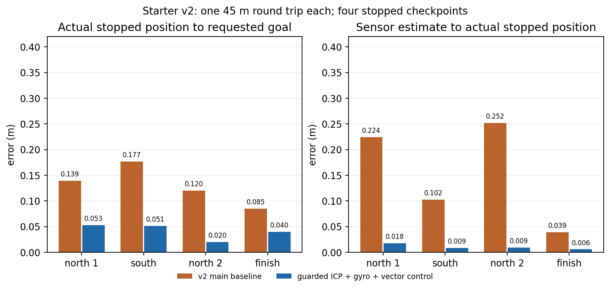

# CSH 미션 1·공통 이동·플래너 — 2026-11-27 KST

최신 Starter v2에서 M1은11/11 PASS였다(왕복 probe 제외). seed301 M1→2 두 case, 실제 LLM 웹 입력2/2, 담당자 코드 M2→4→1 연속3/3과 M3도 통과했다. M6는0/1 FAIL로 남았다. 45m 왕복 네 정지 지점의 최대 추정 오차는 baseline0.252m →0.018m, 실제 목표 오차는0.177m →0.053m였다. 각 구현1회의 비교다.

## 기반·범위·변경 이유

작업 시작 때 fetch한 main은 `7542e7efbbaf1f55c47d92a8acbc12070df37538`이었다. 작업 중 main에 조교 Starter v2가 통합된 것을 확인해 최신 `56f307d84934d3efc0076fa58a963ad9eb2204b2`를 병합했다. v2 실행 구현은 `a3c56be`, 평가 조건 고정은 `2cae201`, 평가 도구·인계 자료는 `ea53835`다. 이 브랜치는 `opt/m1-CSH-20261127-02`, 전용 worktree는 `/home/aril/rai-worktrees/CSH-m1-20261127-02`다. 같은 이니셜의 기존 작업과 프로세스를 발견해 별도 번호를 사용했다.

README·custom README·VALIDATION_REPORT·실제 위치의 `docs/TEAM_OPTIMIZATION.md`, 공식 API/referee/센서 코드와 원본 실패 로그를 먼저 확인했다. M3 로그의 0.6초/1.739m·46도 점프, M2/4 담당자의 장거리 위치 손실을 재현 대상으로 삼았다. 최신 v2에서는 공개 센서 API와 `/g1/respawned` Empty를 따르고 상태 토픽에 의존하는 예전 구현을 이식했다.

- 기존 KISS는 정합을 지도에 반영한 뒤 pelvis 점프를 검사했다. 이제 움직임·raw IMU 회전 일치·대응점 비율 ≥0.55·잔차 ≤0.16m·pelvis 변환을 검증한 뒤 지도와 예측을 갱신한다. 거절된 스캔은 마지막 신뢰 지도를 보존한다. 기존 점프 한계를 완화하거나 waypoint/정답으로 위치를 덮어쓰지 않았다.
- 스캔 시각의 robot TF와 두 스캔 사이 100Hz LiDAR IMU 회전을 사용한다. IMU는 회전 예측이며 평행이동은 반드시 실제 ICP 정합에서 얻는다. 끝 IMU가 아직 도착하지 않았으면 동일 스캔을 재시도하되 이전 측정의 시각·수신 시각을 갱신하지 않는다. 실제 이력 손실과 1초 초과 정합 간격은 차단한다.
- 새로 채택한 스캔의 원래 시각으로만 Pose/TF를 발행한다. Navigator는 좌표계·유한 값·quaternion·측정 시각·수신 지연·sensor clock을 검사하고, 무효 추정에서 정지 후 최대 0.8초 재관측한다. 정체에는 두 번의 유한 재관측과 한 번의 경로 재계획만 허용한다. 모든 기존 공개 메서드 시그니처와 `Stale localization:` 예외 접두어는 유지한다.
- 이동 벡터를 정규화한 뒤 기존 축별 보행 제한을 적용한다. 예전 독립 clipping은 서쪽 목표에도 북쪽 약0.18m/s를 섞어 벽으로 향할 수 있었다. 제공 보행 정책·속도 상한은 그대로다. 같은 방 안에서는 불필요하게 복도로 나가는 경로도 피한다.
- M1은 명령의 goal을 우선하고 유한 숫자·공개 범위 x=14..17/y=1..20을 검증한다. 내부 정지 허용치0.18m, 원본 referee의0.5m 판정은 유지한다. `begin_mission()` 반환값을 현재 자세로 쓰지 않는다.
- 실제 CPU Qwen을 유지하며 한영 순서·색·필수 인자 예시를 보강했다. 모델 자식 프로세스 하나에서 가중치를 재사용하고 요청 전체에45초 상한, 종료 정리에 최대2초를 둔다. 응답 캐시나 규칙으로 의미를 보충하지 않는다. 중복 JSON 키·NaN·알 수 없는 인자·추가 문장을 거절한다. v2에서는 명시적인 팀 사설/localhost/Tailscale 서버만 선택적으로 허용하고 외부 LLM API·redirect·환경 proxy를 차단한다.

| 제출 실행 변경 | 목적 |
|---|---|
| `localization.py`, `localizer_node.py` | 스캔 시각·gyro·공개 리스폰·품질·health 발행 |
| 새 `inertial.py`, `icp_registration.py` | 유한 IMU 이력과 지도 갱신 전 검증 |
| `navigation.py` | 오래된 위치 차단, 방향 보존 속도, 유한 복구/재계획 |
| `mission_1/mission_1.py` | 명령 인자·범위 검사, 종료 시 정지 |
| `planner/planner.py`, `local_model.py`, 새 `worker.py` | 실제 한영 모델, 가중치 재사용, 엄격한 출력/endpoint |
| `testing/`, `tests/`, README·이 문서 | 원본 판정 재현, 수치·계약 검사, 인계 |

## v2 실제 판정

모든 실행은 `haic_rai301_v2`, 전용 src import, 공용 GPU lock 한 번, `HAIC_MAP_CORRECTION=0` 조건이다. baseline은 최신 main `56f307d`를 별도 detached worktree에서 먼저 실행했다. 아래 시간은 별도 표시가 없으면 원본 referee의 미션 시간이다.

| 조건 | PASS / 시도 | 시간·원본 실제 오차 |
|---|---:|---|
| baseline seed301 M1→2, case0/1 | 각2/2 | 45.24 /45.33초 |
| 개선 seed301 M1→2, case0/1 | 각2/2 | 45.28 /48.76초 |
| 기본 wrapper M1 | 1/1 | PASS22.59초,0.062m |
| low(14.1,1.2) /high(16.9,19.8) | 2/2 | 33.12/28.13초,0.041/0.076m |
| room-start(20,10.5,180°)→(15,5) | 1/1 | 32.17초,0.057m |
| cone-start(15.5,24,-90°)→(16,11) | 1/1 | 37.94초,0.047m |
| 미사용 seed9607: (15.17,15.30)/(16.56,13.41) | 2/2 | 15.73/10.27초,0.065/0.067m |
| 실제 LLM 웹 프로토콜 M1→2 | 2/2 | 22.98+23.57초,명령→최종판정72.0초 |
| 담당자 코드 M2→4→1, 리셋 없음 | 3/3 | 50.15+190.36+37.73=278.24초 |
| M3 기본 | 1/1 | PASS245.86초,리스폰0회 |
| M6 기본 | 0/1 | FAIL57.19초,공(9.273,7.928)은 골대 밖 |

seed301의 짧은 구간은 더 빨라졌다고 주장하지 않는다. low/high 실행 일부와 추가 Qwen 검사3개를 CPU에서 병행했으므로 이 두 시간도 순수 지연 benchmark가 아니다. baseline과 개선본의 왕복에는 Qwen 검사를 병행하지 않았다. 새 seed9607은 v2 이식 후 실행 전에 고정했고 결과를 본 뒤 제어기를 조정하지 않았다.

M2/4 연속 시험은 별도 평가용 worktree에서 M2 `2284468`, M4 `36d6ee5`의 명시한 파일만 겹쳤다. v2 호환은 Mission import를 공개 `SensorMission`으로 바꾸는 데 한정했다. 제출 브랜치의 다른 미션 본문과 vision/VLM은 최신 main 그대로다. 실제 M2 종료 콘 구역에서 M4로 이동했고 방3/3 정답과 교실(19.97,10.49) 진입으로 PASS했다. 그 위치에서 M1을 선택해 목표(15,5)로 돌아왔고 실제 오차0.02m였다. 리스폰은0회다. 한 번 거절된 ICP18.7도 제안은 지도에 반영하지 않았고 센서 health는0.248초 후 회복했다. 이는 전역 재위치 추정이나 좌표 재앵커가 아니다. 소스와 import 변경은 `v2_integration_manifest.json`에 있다.

M3는 입구→출구 통과·출구 영역 판정으로 PASS했고 스캔 거절/재앵커/리스폰은 모두0회였다. M6는 실제 공 관측(9.39,8.16)·접근 이후 공 좌표 변동과 추적 단절이 있었고 `Push budget exhausted or ball lost`로 종료했다. 동작 중 invalid localization·스캔 거절·재앵커는0회, 정지 후 마지막 추정과 공식 pelvis 차이는 약0.005m였다. 이 한 지점의 비교를 전체 경로 정답 오차로 해석하지 않는다. 최종 공(9.273,7.928)은 골대에 들어가지 않았다. `observations=0`은 첫 공 검출이 없었다는 뜻이 아니므로 실제 검출 로그도 함께 인계한다. 관측 대상의 정확한 동일성/추적 실패 원인을 이미지 증거 없이 단정하지 않으며, M6 본문·공통 vision은 담당자 영역으로 유지했다.

## 긴 왕복: 판정과 위치 오차를 분리

(16,11)→(16,18.5)→(16,3.5)→(16,18.5)→(16,11)의 총45m 이동 후 각 지점에서 정지해 공식 judge를 읽었다. checkpoint 값은 제어기로 되돌려 보내지 않았다. 이는 공통 Navigator probe이며 보통의 `Mission1.run()` 시도 수와 별도로 센다. 최종 referee PASS뿐 아니라 네 이동·heading 완료 여부도 모두 확인했다.

| v2 왕복 1회씩 | baseline | 개선 |
|---|---:|---:|
| 전체 probe와 최종 판정 | PASS | PASS |
| 시간 |166.82초|160.06초|
| 네 지점 실제 목표 오차 |0.139/0.177/0.120/0.085m|0.053/0.051/0.020/0.040m|
| 네 지점 추정↔실제 위치 오차 |0.224/0.102/0.252/0.039m|0.018/0.009/0.009/0.006m|



개선 왕복의 서로 다른 채택 측정은960개였고 거절·재앵커는0회였다. 센서 간격 중앙값/95%는0.20/0.20초(최대0.50초), localizer.update 소요는139/201ms(최대466ms)였다. M3 갱신 소요 중앙값/95%는155/222ms였다. 이는 노드 내부 갱신 소요이며 센서 획득→소비자 제어까지의 전체 지연을 분해한 측정은 아니다.

한 번씩의 작은 비교이며 개별 gyro·ICP·제어 수정의 기여를 분리한 ablation은 아니다. 연속 ground truth 오차·절대 yaw 오차·실제 넘어짐 후 완전 재개는 측정하지 않았다. 센서 간격·정합/갱신 소요·거절·재앵커 수는 `v2_trace_summary.json`에 별도로 남겼다. 오래된 스캔을 새 시각으로 발행해 개선처럼 보이게 하지 않았다.

## 실제 LLM·검사·환경

v1 단계의 실제 Qwen9개(개발3/평가6)에서 한영 순서·좌표·세 색·누락/미지원 명령의 기대 결과를 확인했다. v2 환경의 추가 명령3개도 통과했다. 한국어 좌표→파란 콘→축구, 영어 주황 콘→좌표는 순서·인자를 보존했다. 색 없는 콘→절벽은 모델이 color 없는 params를 냈고 검증기가 전체 실행을 거절했다. 모델이 모든 오류를 스스로 고친다고 주장하지 않는다. 실제 raw 출력과 기대값은 `v2_planner_probe.json`, 세 요청은 같은 PID를 사용했고22.99/18.03/12.56초였다. 문장·출력 길이가 달라 이 시간 차이를 초기화 절감률로 계산하지 않는다.

v1의 동일 새 prompt/문장 비교는 one-shot20.35초, persistent cold17.95초, warm15.24/14.81초였다. 작은 혼합 부하 측정이며 원래 짧은 영어 prompt15.96초와 비교해 전체 속도 향상이라고 부르지 않는다. 실제 웹 시험은 영어 명령 `Walk to (15.5, 18.0), then go to the green cone.`를 stock `--llm-web`의 request-file 프로토콜로 보냈다. 브라우저 클릭과 한국어 전체 웹 주행은 수행하지 않았다. 두 미션 PASS와 progress `done` 후 대기 호스트를 정상 중단하므로 최종 공식 파일의 호스트 `complete=false/interrupted`와 구분한다.

- 최신 v2 baseline 공통54개, 이 브랜치94개 검사 PASS, 새 환경 `pip check` 정상. 실제 KISS 수치 정합과 거절 전 지도 불변성, gyro/시각/지연, 오래된 자세·정체·복구 상한, M1 입력·정지, 모델 worker 재사용·timeout/EOF/오류를 검사했다.
- 담당자 검사44개는 담당자의 기존 `RGBD.cone(color,data=None)` 변경까지 포함한 별도 CPU fixture에서 PASS했다. main vision.py만 쓰면 해당 선택 인자 검사 한 개의 세 색 subtest가 오류다. 이 차이와 최초 import 경로 설정 실패는 원본 로그에 보존했다. 실제 연속 시험은 main vision.py를 사용했으며 M2의 cone override가 동작했다. 공유 vision 본문을 이 브랜치에서 수정하지 않았다.
- 실행 Python·cwd·HAIC_ROOT·PYTHONPATH·실제 `__file__`은 `v2_imports.json`으로 확인했다. 기존 환경을 업그레이드하지 않고 통합 담당자가 별도로 준비한 `haic_rai301_v2`를 썼다. 신규 의존성은 없다. 버전은 `v2_dependencies.json`에 있다.
- 필수 Qwen/SmolVLM 실제 가중치는 이 worktree의 `src/custom/models/`에 읽기 전용 일반 파일로 포함했다. 약4.1GB 가중치를 Git에 넣지 않으며 revision·해시 manifest와 `custom/tools/download_models.py`로 전달한다. 새 제출 패키지에도 실제 모델 파일을 포함해야 한다. 연결된 API를 실제 시험에 사용하지 않았다.
- `v2_scope_audit.json`에서 공식 관리 영역·다른 미션 본문·vision/VLM·sensor/walking 설정·의존성·공개 map의 최신 main 대비 차이는0개다. 조교 변경은 upstream 병합으로만 수신했다. mission-status/gt odom/시나리오/정답을 제어에 읽거나 미션 코드에서 judge/randomize를 호출하지 않는다. localizer는 SimLink 없이 공개 센서 전용 노드로 실행한다.

공개 리스폰 알림은 문서에 명시된(16,11,0°)에서만 초기화한다. 캐시 스캔은 버리고 채택 측정 시각은 비워 새 관측을 기다리는 계약을 검사했다. 실제 강제 추락 후 전체 임무 재개,6개 전 미션 연속,녹화 부하,새 PC 재설치 검증은 하지 않았다. SciPy fallback은 이번 실제 실행 대상이 아니며 개선 검증은 고정 KISS1.3 경로에 한정한다. 완전한 전역 재위치 추정은 구현하지 않았다.

팀 v2 통합 보고서가 기록한 Rulebook26쪽의 팀 학습 G1 action policy/학습 증빙 요구사항도 별도 과제다. 현재 `robot.yaml`의 `walking.policy:null`은 제공 보행 정책이므로 팀 학습 정책 또는 제공 정책 예외 확인이 필요하다. 주행 PASS를 대회 준비 완료로 표현하지 않는다. M6 등 담당 범위 밖 수정과 최소 재현·호환 요청은 `experiments/CSH/m1/DEPENDENCY_REQUEST.txt`에 남긴다.

## 재현·증거·전달

아래는 이 PC의 전용 worktree에서 시작한다. env.sh는 src로 이동한다. 새 출력 폴더를 사용하고 모델 파일을 먼저 준비한다. 일반 실행은 wrapper가 lock을 잡고, 평가 하네스에는 바깥 flock 한 번만 쓴다.

```bash
cd /home/aril/rai-worktrees/CSH-m1-20261127-02
source experiments/CSH/m1/env.sh
python -m unittest discover -s custom/tests -v
bash custom/tools/run_sim.sh --headless --missions 1 --no-wait
flock -n /tmp/rai-gpu-simulator.lock python custom/testing/randomized_suite.py \
  --seed 301 --cases 2 --missions 1 2 --output ../experiments/CSH/m1/repro-v2-seed301
flock -n /tmp/rai-gpu-simulator.lock python custom/testing/m1_regression.py \
  --case low --case high --case room-start --case cone-start --case roundtrip \
  --output ../experiments/CSH/m1/repro-v2-navigation
flock -n /tmp/rai-gpu-simulator.lock python custom/testing/web_smoke.py \
  --output ../experiments/CSH/m1/repro-v2-web
flock -n /tmp/rai-gpu-simulator.lock python custom/testing/m1_regression.py \
  --case mission3 --case mission6 --output ../experiments/CSH/m1/repro-v2-other
```

M2/4 담당자 연속 시험은 아래처럼 별도 평가 worktree를 만든다. 기존 경로를 덮어쓰지 않는다. `2284468`/`36d6ee5` Git 객체는 해당 소유자 원격 브랜치에서 먼저 fetch해야 한다. 이 overlay를 main으로 자동 병합하지 않는다.

```bash
python ../experiments/CSH/m1/prepare_v2_integration.py --output /tmp/CSH-v2-owner-repro
HAIC_VLM_MODEL="$HAIC_ROOT/src/custom/models/SmolVLM-500M-Instruct" \
  flock -n /tmp/rai-gpu-simulator.lock python custom/testing/m1_regression.py \
  --source /tmp/CSH-v2-owner-repro/src --case cone-delivery-return \
  --output ../experiments/CSH/m1/repro-v2-owner
```

작은 원본 설정·소스 해시·실패 로그·JSON은 `experiments/CSH/m1/v2-*`에, custom 안의 사본과 manifest는 [v2 증거](CSH_m1_20261127/v2/manifest.json)에 있다. 전체 raw trace는 로컬에 보관하고 compact summary를 Git에 넣는다. 바깥 v2 검증 세션이 마지막 case 이후 종료코드143을 반환한 사실은 `v2_batch_status.json`/RUN_NOTES에 별도 공개했다. 모든 해당 case worker는0으로 종료했고 마지막 M3/M6 공식 JSON은 complete=true다. 바깥 세션의 신호 원인은 확인되지 않았으며 판정과 혼동하지 않는다. 원본 로그의 공백도 유지하며 실험 폴더의 `.gitattributes`로 log만 whitespace 검사에서 제외한다. 소스 diff 검사는 통과한다. v1 조건·실패·비교·이전 seed9407/9509와 실제 M3/M6 시험은 [v1 이력](CSH_m1_20261127/v1_history.md)에서 보존하며 v2 성공 수에 더하지 않는다.

게시에는 쓰기 인증이 필요하다. 현재 HTTPS 자격 증명이 없고 연결된 GitHub 앱 계정은 저장소 push 권한이 없으며 SSH publickey도 거절됐다. 자격 증명·개인키를 출력/복사하거나 공유 Git 설정을 바꾸지 않았다. 코드·보고서 커밋과 전달용 `experiments/CSH/m1/delivery.patch`·`delivery.bundle`은 인증 없이 준비한다. 최종 실제 push 결과는 로컬 `experiments/CSH/m1/delivery_push.log`, 전달 커밋·해시는 `delivery_manifest.json`에 기록한다. 이 생성 파일들은 재귀 커밋을 피하려고 Git에서 제외한다. 인증 후 `bash experiments/CSH/m1/publish.sh`는 이 브랜치만 명시적으로 올리고 force/main 병합을 하지 않는다.

근거: [KISS-ICP 논문](https://www.ipb.uni-bonn.de/wp-content/papercite-data/pdf/vizzo2023ral.pdf), [사용한1.3 구현의 지도 갱신 순서](https://github.com/PRBonn/kiss-icp/blob/v1.3.0/python/kiss_icp/kiss_icp.py), [ROS2 Humble TF의 시각/timeout 계약](https://github.com/ros2/geometry2/blob/humble/tf2_ros_py/tf2_ros/buffer.py), [Qwen 공식 모델 카드](https://huggingface.co/Qwen/Qwen2.5-1.5B-Instruct)를 검토했다. 논문·모델 카드의 일반 성능을 우리의 대회 성공률로 인용하지 않았다.
